  

  

  
  
  
 

---

##  Sobre mim

Sou estudante de Ciência da Computação pela Universidade Anhembi Morumbi e atuo como desenvolvedor Full Stack. Embora possua experiência em desenvolvimento tanto no front-end quanto no back-end, minha principal área de interesse e especialização é o desenvolvimento back-end.

Tenho experiência com linguagens como Python, Java e PHP, além de frameworks como Spring Boot e Laravel, utilizados no desenvolvimento de aplicações escaláveis e de alta performance. Também possuo conhecimentos na área de bancos de dados, trabalhando com MySQL, SQL e outras tecnologias relacionais para modelagem, consulta e gerenciamento de dados.

Atualmente, busco aprofundar meus conhecimentos em Inteligência Artificial, desenvolvimento com Python e engenharia de dados, com o objetivo de expandir minhas competências técnicas e acompanhar as transformações tecnológicas que vêm impactando o mercado.

Sou motivado por desafios, aprendizado contínuo e pela oportunidade de desenvolver soluções que gerem valor real para usuários e organizações, sempre buscando evoluir tanto tecnicamente quanto profissionalmente.

---

##  Stack

  
  
  
  
  
  
   
  
  
  
  
  

---

##  GitHub Stats

  
  

---

##  Contato

  📩 <b>Aberto a oportunidades e colaborações — vamos conversar?</b>

<table align="center">
  <tr>
    <td align="center"></td>
    <td align="center"></td>
    <td align="center"></td>
  </tr>
</table>

  

